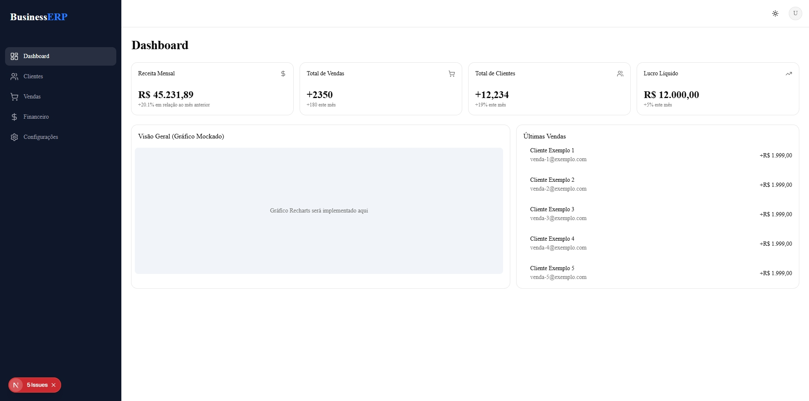

# BusinessERP



Sistema de Gestão Empresarial (ERP / SaaS) moderno desenvolvido com Next.js, Tailwind CSS e Prisma ORM.

## 🚀 Tecnologias

- **Framework:** [Next.js](https://nextjs.org/) (App Router, React 19, TypeScript)
- **Estilização:** [Tailwind CSS v4](https://tailwindcss.com/) & [Lucide React](https://lucide.dev/)
- **UI Components:** Shadcn UI / Base UI
- **Banco de Dados & ORM:** SQLite com [Prisma](https://www.prisma.io/)
- **Autenticação:** [NextAuth.js](https://next-auth.js.org/) com JWT & bcryptjs
- **Gráficos:** [Recharts](https://recharts.org/)

## 📦 Estrutura e Funcionalidades

- **Multi-Tenant (Multi-empresa):** Isolamento de dados por empresa (`Company`).
- **Autenticação e Permissões:** Perfis `ADMIN` e `EMPLOYEE`.
- **Dashboard:** Métricas chave de receita, vendas, clientes e gráficos.
- **Módulos:** Clientes, Vendas e Financeiro (Entradas e Despesas).

## 🛠️ Como Executar o Projeto

1. Clone o repositório:
```bash
git clone https://github.com/EduBraga7/businessERP.git
cd businessERP
```

2. Instale as dependências:
```bash
npm install
```

3. Configure o arquivo `.env`:
```env
DATABASE_URL="file:./dev.db"
NEXTAUTH_SECRET="seu-segredo-aqui"
NEXTAUTH_URL="http://localhost:3000"
```

4. Execute as migrações e o seed do banco de dados:
```bash
npx prisma db push
npx tsx prisma/seed.ts
```

5. Inicie o servidor de desenvolvimento:
```bash
npm run dev
```

Abra [http://localhost:3000](http://localhost:3000) no navegador.

### 🔑 Credenciais Padrão (Seed)
- **E-mail:** `admin@empresa.com`
- **Senha:** `admin123`
